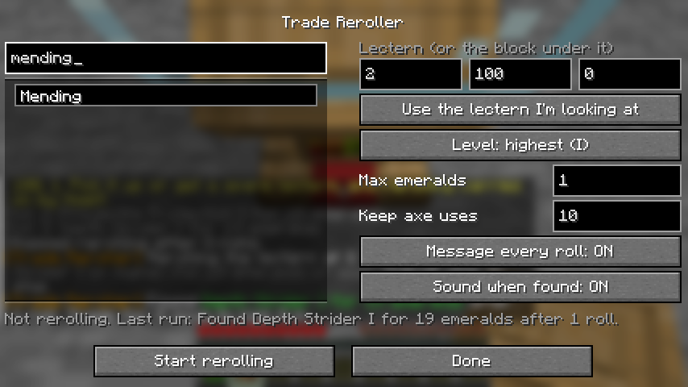

# Trade Reroller

Client-side Fabric mod for Minecraft 26.2 that rerolls a librarian's enchanted book trade for you.
It checks the trades, breaks the lectern with your axe, waits for the villager to lose its job,
puts the lectern back, and checks again. It stops when the book you asked for shows up. The
server doesn't need any mods.



## Usage

Stand next to the lectern and the villager, with an axe and the lectern within reach.

**From the screen:** `/reroll menu`, Trade Reroller's config button in
[Mod Menu](https://modrinth.com/mod/modmenu), or bind a key to **Open Trade Reroller** in Controls.
Opened from the title screen, you can change the limits, but picking the enchantment and starting
need a world.
- Search for the enchantment and click it.
- Look at the lectern before opening the screen and its coordinates fill in. You can also type
  them, or use the coordinates of the block it stands on.
- **Level** is the lowest level that counts. By default it's the highest level the enchantment has.
- **Max emeralds** is the most the book can cost. Leave it empty for any price.
- **Start rerolling** closes the screen and starts. Your choices are saved for next time.

**From chat:**

| Command | Effect |
| --- | --- |
| `/reroll start <x y z> <enchantment> [level] [max price]` | Start. The coordinates can be the lectern or the block under it |
| `/reroll start` | Start again with the saved choices |
| `/reroll stop` | Stop |
| `/reroll` | What it's doing and how many rolls so far |
| `/reroll menu` | Open the settings screen |

When the book shows up, the trade screen stays open with a sound. **Trade for it once** to lock
it in; a villager keeps its trades for good after its first trade.

## Things it checks

- **The axe:** it uses any axe in your inventory, moving it to your hotbar if needed. It stops
  before the axe gets down to its last 10 uses (change this in the screen), so it never breaks.
- **Traded villagers:** if the librarian has been traded with, its trades can't change, so it
  stops without breaking anything.
- **The lectern:** it needs one in your inventory to put back. Usually you pick up the one that
  drops. If it lands out of reach, often in the villager's space, the mod pauses and says where.
  Pick it up or grab a spare, and it carries on by itself. Carrying a spare lectern saves the trip.
- **The villager:** a villager that takes a different job, walks off, or doesn't take the lectern
  within 2 minutes stops the run with a message. Villagers don't take jobs while they're asleep.

## Building

Requires JDK 25.

```bash
./gradlew build
```

`./gradlew runClientGameTest` runs a real survival reroll: a villager in a glass cell, the axe in
the main inventory, and no spare lectern. It checks rolls, the axe moving to the hotbar and
wearing down, finding a book on the first look, the settings screen (search, a bad price, Start
and Stop, saved settings, opening from Mod Menu on the title screen), pausing when a lectern lands
out of reach, and that a worn-out axe and a traded villager are both refused.
